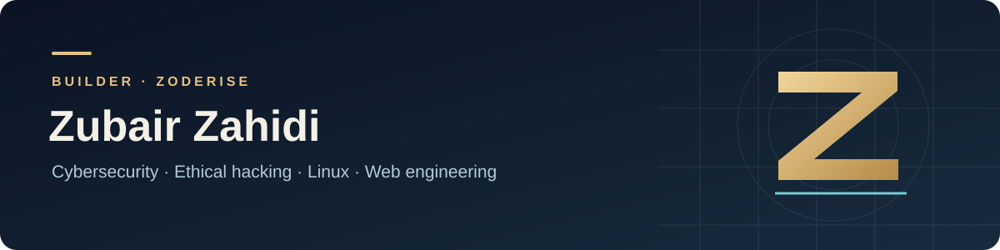

  

I build applications that make information easier to explore, understand, and use. My work at **Zoderise** spans local AI workspaces, interactive visualizations, learning tools, and full-stack web projects.

My recent focus is turning prototypes into usable applications: clear interfaces, practical documentation, Windows distribution, and workflows people can follow.

### Featured work

| Zoderise Horizon | Zoderise 3D Map |
| :--- | :--- |
|  |  |
| A local AI workspace with uploaded-document research, study tools, personal appearance settings, and a shared laptop Hub. | An interactive 3D Earth application with public data sources, visual styles, and Windows distribution. |
| **Python · Streamlit · Ollama** | **JavaScript · Cesium · Electron** |
| [Explore the source](https://github.com/Zubair-zahidi/zoderise-horizon) · [Windows release](https://github.com/Zubair-zahidi/zoderise-horizon/releases/latest) | [Explore the source](https://github.com/Zubair-zahidi/zoderise-3d-map) · [Windows release](https://github.com/Zubair-zahidi/zoderise-3d-map/releases/latest) |

### More projects

- **[STARZ NEXUS](https://github.com/Zubair-zahidi/starz-chatbot-ui)** — A conversational application prototype with a TypeScript frontend and Node.js backend.
- **[Cybersecurity Learning Platform](https://github.com/Zubair-zahidi/zoderise-cybersecurity-learning-platform)** — A React and Node.js project exploring learning modules, practice tools, and an administration interface.
- **[Cosmic Books](https://github.com/Zubair-zahidi/BookStore-backend-frontend)** — A full-stack bookstore project with a visual catalog, account workflows, and a shopping cart interface.
- **[Portfolio iterations](https://github.com/Zubair-zahidi/zubair-zahidi-portfolio)** — Five versions documenting the evolution of my personal web design.

### How I work

**Languages:** Python, TypeScript, JavaScript, HTML, and CSS.  
**Application tools:** Streamlit, React, Node.js, Express, and Ollama.  
**Interests:** local AI, document workflows, interactive learning, 3D interfaces, and defensive security education.

I aim to explain what a project does, how to run it, and where its limitations matter. AI-generated answers need human review; a polished interface is only one part of a reliable application.

### Explore and connect

Start with the featured repositories for screenshots, setup guides, and releases. For a project question or a reproducible bug, open an issue in the relevant repository.

---

<strong>Zubair Zahidi · Zoderise</strong> Building useful tools through code, design, and iteration.

